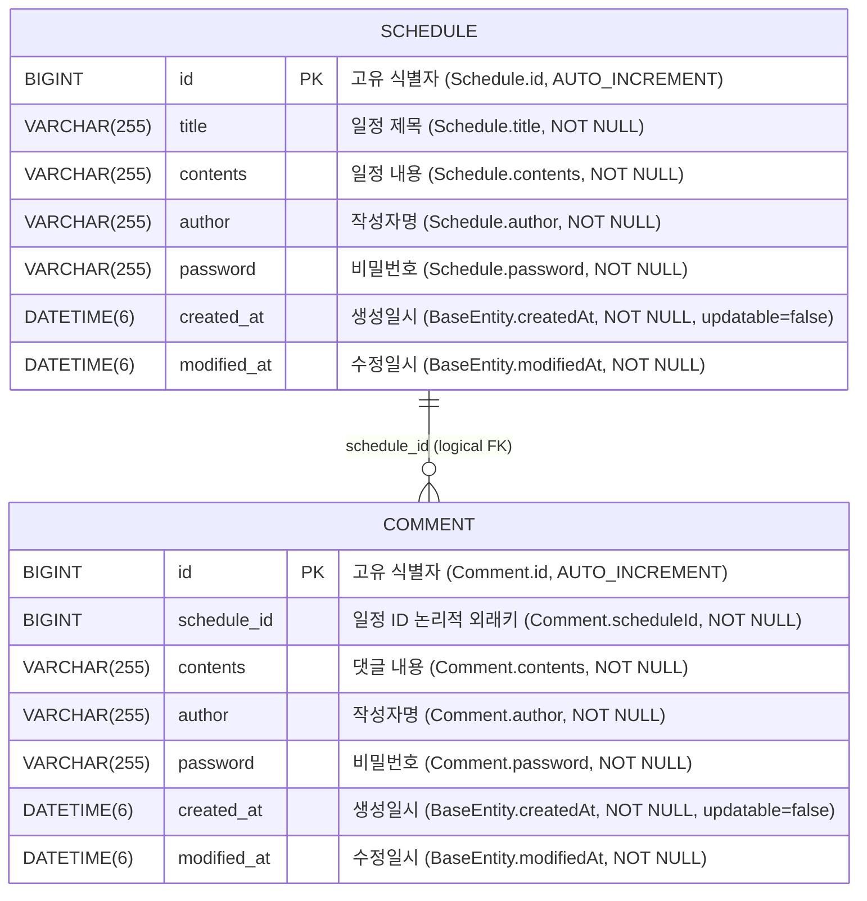

# Schedule App (일정 관리 애플리케이션)

Spring Boot와 Spring Data JPA 기반의 일정 및 댓글 관리 REST API 서버입니다.  
3-Layer Architecture(`Controller` - `Service` - `Repository`)를 적용하여 계층별 책임을 분리하였으며, JPA Auditing(`BaseEntity`, `JpaAuditingConfig`)을 통해 생성일시와 수정일시를 자동으로 관리합니다.

---

## 1. 프로젝트 개요 및 기술 스택

### Lv 1 ~ Lv 7 기능 구현 현황

| 단계 | 기능 | HTTP Method & URI | Controller 메서드 | Service 메서드 | 구현 상태 |
| :--- | :--- | :--- | :--- | :--- | :---: |
| **Lv 1** | 일정 생성 | `POST /api/schedules` | `ScheduleController.createSchedule` | `ScheduleService.createSchedule` | ✅ 완료 |
| **Lv 2** | 전체 일정 조회 (작성자 필터 선택) | `GET /api/schedules` | `ScheduleController.getSchedules` | `ScheduleService.getSchedules` | ✅ 완료 |
| **Lv 2 · Lv 6** | 단건 일정 조회 (연관 댓글 목록 포함) | `GET /api/schedules/{id}` | `ScheduleController.getSchedule` | `ScheduleService.getSchedule` | ✅ 완료 |
| **Lv 3** | 일정 수정 (제목, 작성자명) | `PATCH /api/schedules/{id}` | `ScheduleController.updateSchedule` | `ScheduleService.updateSchedule` | ✅ 완료 |
| **Lv 4** | 일정 삭제 (연관 댓글 일괄 삭제 포함) | `DELETE /api/schedules/{id}` | `ScheduleController.deleteSchedule` | `ScheduleService.deleteSchedule` | ✅ 완료 |
| **Lv 5** | 댓글 생성 (일정당 최대 10개 제한) | `POST /api/schedules/{scheduleId}/comments` | `CommentController.createComment` | `CommentService.createComment` | ✅ 완료 |
| **Lv 6** | 단건 조회 시 댓글 포함 및 전체 조회와 응답 DTO 분리 | `GET /api/schedules/{id}`<br>`GET /api/schedules` | `ScheduleController.getSchedule`<br>`ScheduleController.getSchedules` | `ScheduleService.getSchedule`<br>`ScheduleService.getSchedules` | ✅ 완료 |
| **Lv 7** | 순수 Java 기반 입력값 유효성 검증 | 전 API 요청 본문 | - | `InputValidator` (`ScheduleService`, `CommentService`) | ✅ 완료 |

- **Lv 1 (일정 생성)**: 제목(`title`), 내용(`contents`), 작성자명(`author`), 비밀번호(`password`)를 전달받아 일정을 저장하고, `password`를 제외한 `ScheduleResponseDto`와 `201 Created`를 반환합니다.
- **Lv 2 (일정 조회)**:
  - **전체 조회**: 선택적 쿼리 파라미터 `author`가 없거나 공백(`isBlank()`)이면 `findAllByOrderByModifiedAtDesc()`로 전체 일정을, 값이 있으면 `findAllByAuthorOrderByModifiedAtDesc(author)`로 해당 작성자의 일정을 수정일(`modifiedAt`) 기준 내림차순으로 조회합니다.
  - **단건 조회**: 경로 변수 `id`로 일정을 조회하며, 존재하지 않으면 `ScheduleNotFoundException`(`404 Not Found`)이 발생합니다.
- **Lv 3 (일정 수정)**: 비밀번호 검증 성공 시 `Schedule.update(title, author)`를 통해 제목(`title`)과 작성자명(`author`)만 수정하며, 내용(`contents`)과 생성일시(`createdAt`)는 유지됩니다. `scheduleRepository.flush()`를 호출해 트랜잭션 커밋 전 변경 감지를 즉시 반영하여 갱신된 `modifiedAt`을 응답 DTO에 포함합니다.
- **Lv 4 (일정 삭제)**: 일정 존재 여부와 비밀번호 일치 여부를 검증한 뒤 `commentRepository.deleteAllByScheduleId(id)`로 연관 댓글을 먼저 일괄 삭제하고 `scheduleRepository.delete(schedule)`로 일정을 삭제한 다음, 본문 없이 `204 No Content`를 반환합니다.
- **Lv 5 (댓글 생성)**: 대상 일정 존재 여부(`scheduleRepository.existsById(scheduleId)`)와 일정당 최대 댓글 수(`commentRepository.countByScheduleId(scheduleId) >= 10`)를 검증한 뒤, 논리적 외래키 `scheduleId`를 포함한 `Comment` 엔티티를 저장하고 `password`를 제외한 `CommentResponseDto`와 `201 Created`를 반환합니다.
- **Lv 6 (일정 단건 조회 시 댓글 포함)**: 단건 조회(`GET /api/schedules/{id}`)는 `ScheduleDetailResponseDto`를 반환하여 해당 일정의 댓글 목록(`comments`, 작성일 `createdAt` 오름차순 정렬, 댓글이 없을 경우 빈 배열 `[]` 보장)을 포함합니다. 반면 전체 조회(`GET /api/schedules`)는 기존 `ScheduleResponseDto` 목록을 반환하므로 `comments` 필드가 포함되지 않습니다.
- **Lv 7 (입력값 유효성 검증)**: Bean Validation(`@Valid`, `@NotBlank` 등)을 사용하지 않고 `InputValidator`의 순수 Java 조건문으로 요청 DTO `null` 여부, 필수값 `null`/공백 여부(`isBlank()`), 최대 글자 수(제목 30자, 일정 내용 200자, 댓글 내용 100자)를 DB 조회/비밀번호 검증 전에 선제 검증하며, 위반 시 `InvalidInputException`(`400 Bad Request`)을 반환합니다.

### 기술 스택 (`build.gradle` 기준)

| 구분 | 기술 및 버전 | 비고 |
| :--- | :--- | :--- |
| **Language** | Java `17` | `JavaLanguageVersion.of(17)` |
| **Framework** | Spring Boot `3.5.7` | `io.spring.dependency-management` `1.1.7` |
| **Build Tool** | Gradle | `group = 'com.example'`, `version = '0.0.1-SNAPSHOT'` |
| **Web** | `spring-boot-starter-web` | Spring MVC 기반 REST API |
| **ORM / Data** | `spring-boot-starter-data-jpa` | Hibernate / Spring Data JPA / JPA Auditing |
| **Database** | MySQL (`com.mysql:mysql-connector-j`) | MySQL Connector/J (`runtimeOnly`) |
| **Utility** | Lombok (`org.projectlombok:lombok`) | `@Getter`, `@RequiredArgsConstructor`, `@NoArgsConstructor`, `@AllArgsConstructor` |
| **Test** | `spring-boot-starter-test`, `junit-platform-launcher` | `@WebMvcTest`(`ScheduleControllerTest`, `CommentControllerTest`), Mockito(`ScheduleServiceTest`, `CommentServiceTest`) |

### 핵심 설계 제약 및 아키텍처 특징

1. **JPA 연관관계 미사용**: `Schedule`(`schedules` 테이블)과 `Comment`(`comments` 테이블) 간에 `@OneToMany`, `@ManyToOne` 등의 JPA 연관관계 매핑을 사용하지 않습니다. `Comment` 엔티티는 대상 일정 식별자를 일반 컬럼 `scheduleId`(`schedule_id`)로만 보관(논리적 외래키)하며, 일정 삭제 시 `ScheduleService.deleteSchedule`에서 `commentRepository.deleteAllByScheduleId(id)`를 호출해 연관 댓글을 함께 정리합니다.
2. **Bean Validation 미사용**: `spring-boot-starter-validation` 의존성 및 요청 DTO 내 `@Valid` / `@NotBlank` 등의 검증 어노테이션을 사용하지 않으며, `InputValidator` 유틸리티를 통해 서비스 계층(`ScheduleService`, `CommentService`)에서 `null`/공백 체크(`isBlank()`)와 최대 길이 검증(`InvalidInputException`)을 직접 수행하고, 비밀번호 검증(`validatePassword`) 역시 서비스 계층에서 직접 처리합니다.
3. **응답 내 `password` 제외**: `ScheduleResponseDto`, `ScheduleDetailResponseDto`, `CommentResponseDto` 모두 `password` 필드를 가지지 않으며, 각 DTO의 정적 팩토리 메서드 `from(...)`을 통해 민감 정보를 제외한 필드만 응답합니다.
4. **3-Layer 계층 분리**: `ScheduleController` / `CommentController`(HTTP 요청/응답) → `ScheduleService` / `CommentService`(비즈니스 로직/트랜잭션/입력값·비밀번호 검증) → `ScheduleRepository` / `CommentRepository`(DB 접근)로 책임을 명확히 분리합니다.
5. **JPA Auditing 설정 분리**: `JpaAuditingConfig`를 `ScheduleApplication`과 분리하여 `@WebMvcTest` 같은 웹 슬라이스 테스트 실행 시 JPA 메타모델 빈 충돌이 발생하지 않도록 설계했습니다.

---

## 2. API 명세서

일정 API의 기본 경로는 `/api/schedules`(`ScheduleController`), 댓글 API의 기본 경로는 `/api/schedules/{scheduleId}/comments`(`CommentController`)이며, 요청/응답 본문은 `application/json` 형식을 사용합니다.

### API 요약

| Lv | 기능 | Method | URL | 성공 상태코드 | 실패 상태코드 |
| :-: | :--- | :---: | :--- | :---: | :---: |
| Lv 1 | 일정 생성 | `POST` | `/api/schedules` | `201 Created` | `400 Bad Request` |
| Lv 2 | 전체 일정 조회 | `GET` | `/api/schedules` | `200 OK` | - |
| Lv 2 · Lv 6 | 단건 일정 조회 (댓글 포함) | `GET` | `/api/schedules/{id}` | `200 OK` | `404 Not Found` |
| Lv 3 | 일정 수정 | `PATCH` | `/api/schedules/{id}` | `200 OK` | `400 Bad Request`, `401 Unauthorized`, `404 Not Found` |
| Lv 4 | 일정 삭제 | `DELETE` | `/api/schedules/{id}` | `204 No Content` | `400 Bad Request`, `401 Unauthorized`, `404 Not Found` |
| Lv 5 | 댓글 생성 | `POST` | `/api/schedules/{scheduleId}/comments` | `201 Created` | `400 Bad Request`, `404 Not Found` |

---

### Lv 1. 일정 생성 (`POST /api/schedules`)

새로운 일정을 등록하고 생성된 일정 정보(`password` 제외)를 반환합니다.

| 항목 | 내용 |
| :--- | :--- |
| **Method / URL** | `POST /api/schedules` |
| **Controller** | `ScheduleController.createSchedule(@RequestBody ScheduleCreateRequestDto requestDto)` |
| **Query / Path Parameter** | 없음 |
| **Request DTO** | `ScheduleCreateRequestDto` (`title`, `contents`, `author`, `password`) |
| **Response DTO** | `ScheduleResponseDto` (`id`, `title`, `contents`, `author`, `createdAt`, `modifiedAt`) |
| **성공 HTTP 상태코드** | `201 Created` |
| **실패 HTTP 상태코드** | `400 Bad Request` (`InvalidInputException`: 요청 본문 `null`, 필수값 누락/공백, 제목 30자 초과, 내용 200자 초과) |

**Request JSON (`ScheduleCreateRequestDto`)**
```json
{
  "title": "스프링 과제",
  "contents": "Lv 1 일정 생성 API 구현",
  "author": "김인성",
  "password": "secret1234"
}
```

**Response JSON (`201 Created` - `ScheduleResponseDto`)**
```json
{
  "id": 1,
  "title": "스프링 과제",
  "contents": "Lv 1 일정 생성 API 구현",
  "author": "김인성",
  "createdAt": "2026-11-26T10:00:00",
  "modifiedAt": "2026-11-26T10:00:00"
}
```

**실패 Response JSON (`400 Bad Request` - `ErrorResponse`)**
```json
{
  "status": 400,
  "error": "Bad Request",
  "message": "제목 입력값은 최대 30자까지 입력할 수 있습니다."
}
```

---

### Lv 2-1. 전체 일정 조회 (`GET /api/schedules`)

전체 일정 목록 또는 특정 작성자(`author`)의 일정 목록을 수정일(`modifiedAt`) 기준 내림차순으로 조회합니다.  
단건 조회(`GET /api/schedules/{id}`)와 달리 `ScheduleResponseDto`를 반환하므로 **응답에 `comments` 필드가 포함되지 않습니다.**

| 항목 | 내용 |
| :--- | :--- |
| **Method / URL** | `GET /api/schedules` (예: `GET /api/schedules?author=김인성`) |
| **Controller** | `ScheduleController.getSchedules(@RequestParam(required = false) String author)` |
| **Query Parameter** | `author` (`String`, 선택): 값이 없거나 공백이면 전체 조회, 값이 있으면 해당 작성자의 일정만 조회 |
| **Path Parameter** | 없음 |
| **Request Body** | 없음 |
| **Response DTO** | `List<ScheduleResponseDto>` (`comments` 미포함) |
| **성공 HTTP 상태코드** | `200 OK` |
| **실패 HTTP 상태코드** | 커스텀 예외 없음 (조건에 맞는 일정이 없으면 빈 배열 `[]` 반환) |

**Response JSON (`200 OK` - `List<ScheduleResponseDto>`)**
```json
[
  {
    "id": 2,
    "title": "최신 일정",
    "contents": "내용2",
    "author": "이영희",
    "createdAt": "2026-11-25T09:00:00",
    "modifiedAt": "2026-11-26T10:00:00"
  },
  {
    "id": 1,
    "title": "이전 일정",
    "contents": "내용1",
    "author": "김인성",
    "createdAt": "2026-11-25T09:00:00",
    "modifiedAt": "2026-11-25T09:00:00"
  }
]
```

---

### Lv 2-2 · Lv 6. 단건 일정 조회 (`GET /api/schedules/{id}`)

지정한 `id`에 해당하는 일정 1건과 해당 일정에 등록된 댓글 목록을 함께 조회합니다.  
단건 조회 전용 DTO인 `ScheduleDetailResponseDto`를 사용하여 `comments` 배열을 포함하며(댓글 및 일정 모두 `password` 제외), 댓글은 작성일(`createdAt`) 오름차순으로 정렬됩니다. 등록된 댓글이 없는 경우에도 `null`이 아닌 빈 배열 `[]`을 반환합니다.  
*(전체 조회 `GET /api/schedules`는 `ScheduleResponseDto`를 반환하므로 `comments`가 포함되지 않습니다.)*

| 항목 | 내용 |
| :--- | :--- |
| **Method / URL** | `GET /api/schedules/{id}` |
| **Controller** | `ScheduleController.getSchedule(@PathVariable Long id)` |
| **Query Parameter** | 없음 |
| **Path Parameter** | `id` (`Long`, 필수): 조회할 일정 ID |
| **Request Body** | 없음 |
| **Response DTO** | `ScheduleDetailResponseDto` (`id`, `title`, `contents`, `author`, `createdAt`, `modifiedAt`, `comments`) |
| **성공 HTTP 상태코드** | `200 OK` |
| **실패 HTTP 상태코드** | `404 Not Found` (`ScheduleNotFoundException`: 요청한 `id`의 일정이 존재하지 않는 경우) |

**Response JSON (`200 OK` - `ScheduleDetailResponseDto`, 댓글이 있는 경우)**
```json
{
  "id": 1,
  "title": "단건 일정",
  "contents": "상세 조회 테스트",
  "author": "김인성",
  "createdAt": "2026-11-26T10:00:00",
  "modifiedAt": "2026-11-26T10:00:00",
  "comments": [
    {
      "id": 1,
      "scheduleId": 1,
      "contents": "첫 번째 댓글입니다.",
      "author": "홍길동",
      "createdAt": "2026-11-26T10:10:00",
      "modifiedAt": "2026-11-26T10:10:00"
    }
  ]
}
```

**Response JSON (`200 OK` - `ScheduleDetailResponseDto`, 댓글이 없는 경우)**
```json
{
  "id": 1,
  "title": "단건 일정",
  "contents": "상세 조회 테스트",
  "author": "김인성",
  "createdAt": "2026-11-26T10:00:00",
  "modifiedAt": "2026-11-26T10:00:00",
  "comments": []
}
```

**실패 Response JSON (`404 Not Found` - `ErrorResponse`)**
```json
{
  "status": 404,
  "error": "Not Found",
  "message": "해당 일정을 찾을 수 없습니다. id=999"
}
```

---

### Lv 3. 일정 수정 (`PATCH /api/schedules/{id}`)

지정한 `id`의 일정에 대해 입력값 검증 및 비밀번호 검증을 수행한 뒤 제목(`title`)과 작성자명(`author`)만 수정합니다. 내용(`contents`)과 생성일시(`createdAt`)는 변경되지 않으며, `flush()` 호출로 갱신된 `modifiedAt`이 응답에 반영됩니다.

| 항목 | 내용 |
| :--- | :--- |
| **Method / URL** | `PATCH /api/schedules/{id}` |
| **Controller** | `ScheduleController.updateSchedule(@PathVariable Long id, @RequestBody ScheduleUpdateRequestDto requestDto)` |
| **Query Parameter** | 없음 |
| **Path Parameter** | `id` (`Long`, 필수): 수정할 일정 ID |
| **Request DTO** | `ScheduleUpdateRequestDto` (`title`, `author`, `password`) |
| **Response DTO** | `ScheduleResponseDto` |
| **성공 HTTP 상태코드** | `200 OK` |
| **실패 HTTP 상태코드** | `400 Bad Request` (`InvalidInputException`), `401 Unauthorized` (`InvalidPasswordException`), `404 Not Found` (`ScheduleNotFoundException`) |

**Request JSON (`ScheduleUpdateRequestDto`)**
```json
{
  "title": "수정된 제목",
  "author": "이영희",
  "password": "secret1234"
}
```

**Response JSON (`200 OK` - `ScheduleResponseDto`)**
```json
{
  "id": 1,
  "title": "수정된 제목",
  "contents": "기존 내용",
  "author": "이영희",
  "createdAt": "2026-11-25T09:00:00",
  "modifiedAt": "2026-11-26T10:30:00"
}
```

**실패 Response JSON (`400 Bad Request` / `401 Unauthorized` - `ErrorResponse`)**
```json
{
  "status": 400,
  "error": "Bad Request",
  "message": "제목 입력값은 비어 있거나 공백일 수 없습니다."
}
```
```json
{
  "status": 401,
  "error": "Unauthorized",
  "message": "비밀번호가 일치하지 않습니다."
}
```

---

### Lv 4. 일정 삭제 (`DELETE /api/schedules/{id}`)

지정한 `id`의 일정 존재 여부, 입력값 및 비밀번호를 검증한 뒤 연관된 댓글을 먼저 일괄 삭제하고 해당 일정을 삭제합니다.

| 항목 | 내용 |
| :--- | :--- |
| **Method / URL** | `DELETE /api/schedules/{id}` |
| **Controller** | `ScheduleController.deleteSchedule(@PathVariable Long id, @RequestBody ScheduleDeleteRequestDto requestDto)` |
| **Query Parameter** | 없음 |
| **Path Parameter** | `id` (`Long`, 필수): 삭제할 일정 ID |
| **Request DTO** | `ScheduleDeleteRequestDto` (`password`) |
| **Response Body** | 없음 (빈 본문) |
| **성공 HTTP 상태코드** | `204 No Content` |
| **실패 HTTP 상태코드** | `400 Bad Request` (`InvalidInputException`), `401 Unauthorized` (`InvalidPasswordException`), `404 Not Found` (`ScheduleNotFoundException`) |

**Request JSON (`ScheduleDeleteRequestDto`)**
```json
{
  "password": "secret1234"
}
```

**Response (`204 No Content`)**
- 응답 본문 없음 (`""`)

**실패 Response JSON (`400 Bad Request` / `401 Unauthorized` / `404 Not Found` - `ErrorResponse`)**
```json
{
  "status": 400,
  "error": "Bad Request",
  "message": "비밀번호 입력값은 비어 있거나 공백일 수 없습니다."
}
```
```json
{
  "status": 401,
  "error": "Unauthorized",
  "message": "비밀번호가 일치하지 않습니다."
}
```
```json
{
  "status": 404,
  "error": "Not Found",
  "message": "해당 일정을 찾을 수 없습니다. id=999"
}
```

---

### Lv 5. 댓글 생성 (`POST /api/schedules/{scheduleId}/comments`)

지정한 일정(`scheduleId`)에 새로운 댓글을 등록하고 생성된 댓글 정보(`password` 제외)를 반환합니다.  
입력값 검증을 통과한 뒤 대상 일정 존재 여부를 확인하고, 해당 일정의 댓글 개수가 이미 10개 이상이면 등록을 거부합니다.

| 항목 | 내용 |
| :--- | :--- |
| **Method / URL** | `POST /api/schedules/{scheduleId}/comments` |
| **Controller** | `CommentController.createComment(@PathVariable Long scheduleId, @RequestBody CommentCreateRequestDto requestDto)` |
| **Query Parameter** | 없음 |
| **Path Parameter** | `scheduleId` (`Long`, 필수): 댓글을 등록할 대상 일정 ID |
| **Request DTO** | `CommentCreateRequestDto` (`contents`, `author`, `password`) |
| **Response DTO** | `CommentResponseDto` (`id`, `scheduleId`, `contents`, `author`, `createdAt`, `modifiedAt` — `password` 제외) |
| **성공 HTTP 상태코드** | `201 Created` |
| **실패 HTTP 상태코드** | `400 Bad Request` (`CommentLimitExceededException`: 일정당 댓글 10개 초과, `InvalidInputException`: 입력값 검증 실패)<br>`404 Not Found` (`ScheduleNotFoundException`: 대상 일정 미존재) |

**Request JSON (`CommentCreateRequestDto`)**
```json
{
  "contents": "댓글 내용입니다.",
  "author": "홍길동",
  "password": "comment1234"
}
```

**Response JSON (`201 Created` - `CommentResponseDto`)**
```json
{
  "id": 1,
  "scheduleId": 1,
  "contents": "댓글 내용입니다.",
  "author": "홍길동",
  "createdAt": "2026-11-26T11:00:00",
  "modifiedAt": "2026-11-26T11:00:00"
}
```

**실패 Response JSON (`400 Bad Request` - 댓글 10개 초과: `CommentLimitExceededException`)**
```json
{
  "status": 400,
  "error": "Bad Request",
  "message": "하나의 일정에는 댓글을 최대 10개까지만 작성할 수 있습니다. scheduleId=1"
}
```

**실패 Response JSON (`400 Bad Request` - 입력값 검증 실패: `InvalidInputException`)**
```json
{
  "status": 400,
  "error": "Bad Request",
  "message": "내용 입력값은 최대 100자까지 입력할 수 있습니다."
}
```

**실패 Response JSON (`404 Not Found` - 대상 일정 미존재: `ScheduleNotFoundException`)**
```json
{
  "status": 404,
  "error": "Not Found",
  "message": "해당 일정을 찾을 수 없습니다. id=999"
}
```

---

### Lv 7. 입력값 검증 규칙 (`InputValidator`)

Bean Validation(`@Valid`, `@NotBlank` 등)을 사용하지 않고 `com.example.schedule.common.validation.InputValidator`의 순수 Java 조건문으로 요청 값을 검증합니다.  
모든 생성/수정/삭제 서비스 메서드는 DB 조회 및 비밀번호 비교 이전에 입력값 검증을 먼저 수행하며, 검증 실패 시 `InvalidInputException`이 발생해 `GlobalExceptionHandler`가 `400 Bad Request` `ErrorResponse`를 반환합니다.

| 검증 대상 메서드 | 검증 조건 | 예외 메시지 (`InvalidInputException`) | HTTP 상태코드 |
| :--- | :--- | :--- | :---: |
| `validateRequestNotNull(requestDto)` | `requestDto == null` | `"요청 데이터가 null일 수 없습니다."` | `400 Bad Request` |
| `validateRequired(value, fieldName)` | `value == null` 또는 `value.isBlank()` | `"{fieldName} 입력값은 비어 있거나 공백일 수 없습니다."` | `400 Bad Request` |
| `validateRequiredWithMaxLength(value, fieldName, maxLength)` | `validateRequired` 통과 후 `value.length() > maxLength` | `"{fieldName} 입력값은 최대 {maxLength}자까지 입력할 수 있습니다."` | `400 Bad Request` |

#### API별 필드 검증 규칙 상세

| API / Service 메서드 | 필드명 (`fieldName`) | 필수 여부 (`null`/공백 불가) | 최대 길이 제한 |
| :--- | :--- | :---: | :---: |
| **일정 생성** (`ScheduleService.createSchedule`) | `title` (`"제목"`) | 필수 | 최대 `30`자 (`MAX_TITLE_LENGTH = 30`) |
| **일정 생성** (`ScheduleService.createSchedule`) | `contents` (`"내용"`) | 필수 | 최대 `200`자 (`MAX_CONTENTS_LENGTH = 200`) |
| **일정 생성** (`ScheduleService.createSchedule`) | `author` (`"작성자"`) | 필수 | 제한 없음 |
| **일정 생성** (`ScheduleService.createSchedule`) | `password` (`"비밀번호"`) | 필수 | 제한 없음 |
| **일정 수정** (`ScheduleService.updateSchedule`) | `title` (`"제목"`) | 필수 | 최대 `30`자 (`MAX_TITLE_LENGTH = 30`) |
| **일정 수정** (`ScheduleService.updateSchedule`) | `author` (`"작성자"`) | 필수 | 제한 없음 |
| **일정 수정** (`ScheduleService.updateSchedule`) | `password` (`"비밀번호"`) | 필수 | 제한 없음 |
| **일정 삭제** (`ScheduleService.deleteSchedule`) | `password` (`"비밀번호"`) | 필수 | 제한 없음 |
| **댓글 생성** (`CommentService.createComment`) | `contents` (`"내용"`) | 필수 | 최대 `100`자 (`MAX_CONTENTS_LENGTH = 100`) |
| **댓글 생성** (`CommentService.createComment`) | `author` (`"작성자"`) | 필수 | 제한 없음 |
| **댓글 생성** (`CommentService.createComment`) | `password` (`"비밀번호"`) | 필수 | 제한 없음 |

---

### 공통 예외 처리 명세 (`GlobalExceptionHandler` & `ErrorResponse`)

`com.example.schedule.common.exception.GlobalExceptionHandler`(`@RestControllerAdvice`)가 애플리케이션 전역에서 발생하는 커스텀 예외를 잡아 `ErrorResponse`(`status`, `error`, `message`) 형식으로 변환해 반환합니다.

| 예외 클래스 | 핸들러 메서드 | HTTP 상태코드 | `status` | `error` | `message` |
| :--- | :--- | :---: | :---: | :--- | :--- |
| `ScheduleNotFoundException` | `handleScheduleNotFoundException` | `404 Not Found` | `404` | `"Not Found"` | `"해당 일정을 찾을 수 없습니다. id={id}"` |
| `InvalidPasswordException` | `handleInvalidPasswordException` | `401 Unauthorized` | `401` | `"Unauthorized"` | `"비밀번호가 일치하지 않습니다."` |
| `CommentLimitExceededException` | `handleCommentLimitExceededException` | `400 Bad Request` | `400` | `"Bad Request"` | `"하나의 일정에는 댓글을 최대 10개까지만 작성할 수 있습니다. scheduleId={scheduleId}"` |
| `InvalidInputException` | `handleInvalidInputException` | `400 Bad Request` | `400` | `"Bad Request"` | 검증 실패 사유 메시지 (`InputValidator` 참조) |

---

## 3. ERD

본 프로젝트는 `BaseEntity`를 상속받은 `Schedule`(`schedules` 테이블)과 `Comment`(`comments` 테이블) 엔티티로 구성되어 있습니다.  
JPA 연관관계 매핑(`@OneToMany`, `@ManyToOne`)을 사용하지 않으므로, `COMMENT`의 `schedule_id`는 물리적 외래키 제약조건 없이 `SCHEDULE.id`를 논리적으로 참조합니다.



### 엔티티 - 테이블 컬럼 매핑 상세 (`Schedule`, `Comment`, `BaseEntity`)

#### 1) `Schedule` (`schedules` 테이블)

| 클래스 | Java 필드명 | Java 타입 | JPA 어노테이션 | DB 테이블/컬럼명 (`schedules`) | DB 타입 | 제약조건 |
| :--- | :--- | :--- | :--- | :--- | :--- | :--- |
| `Schedule` | `id` | `Long` | `@Id`, `@GeneratedValue(strategy = GenerationType.IDENTITY)` | `id` | `BIGINT` | `PK`, `AUTO_INCREMENT` |
| `Schedule` | `title` | `String` | `@Column(nullable = false)` | `title` | `VARCHAR(255)` | `NOT NULL` |
| `Schedule` | `contents` | `String` | `@Column(nullable = false)` | `contents` | `VARCHAR(255)` | `NOT NULL` |
| `Schedule` | `author` | `String` | `@Column(nullable = false)` | `author` | `VARCHAR(255)` | `NOT NULL` |
| `Schedule` | `password` | `String` | `@Column(nullable = false)` | `password` | `VARCHAR(255)` | `NOT NULL` |
| `BaseEntity` | `createdAt` | `LocalDateTime` | `@CreatedDate`, `@Column(updatable = false, nullable = false)` | `created_at` | `DATETIME(6)` | `NOT NULL`, 수정 불가 |
| `BaseEntity` | `modifiedAt` | `LocalDateTime` | `@LastModifiedDate`, `@Column(nullable = false)` | `modified_at` | `DATETIME(6)` | `NOT NULL` |

#### 2) `Comment` (`comments` 테이블)

| 클래스 | Java 필드명 | Java 타입 | JPA 어노테이션 | DB 테이블/컬럼명 (`comments`) | DB 타입 | 제약조건 |
| :--- | :--- | :--- | :--- | :--- | :--- | :--- |
| `Comment` | `id` | `Long` | `@Id`, `@GeneratedValue(strategy = GenerationType.IDENTITY)` | `id` | `BIGINT` | `PK`, `AUTO_INCREMENT` |
| `Comment` | `scheduleId` | `Long` | `@Column(nullable = false)` | `schedule_id` | `BIGINT` | `NOT NULL`, 논리적 외래키 |
| `Comment` | `contents` | `String` | `@Column(nullable = false)` | `contents` | `VARCHAR(255)` | `NOT NULL` |
| `Comment` | `author` | `String` | `@Column(nullable = false)` | `author` | `VARCHAR(255)` | `NOT NULL` |
| `Comment` | `password` | `String` | `@Column(nullable = false)` | `password` | `VARCHAR(255)` | `NOT NULL` |
| `BaseEntity` | `createdAt` | `LocalDateTime` | `@CreatedDate`, `@Column(updatable = false, nullable = false)` | `created_at` | `DATETIME(6)` | `NOT NULL`, 수정 불가 |
| `BaseEntity` | `modifiedAt` | `LocalDateTime` | `@LastModifiedDate`, `@Column(nullable = false)` | `modified_at` | `DATETIME(6)` | `NOT NULL` |

---

## 4. 과제 필수 질문 답변

### 질문 1. 3-Layer Architecture(`Controller`, `Service`, `Repository`)를 본 프로젝트에 어떻게 적용했고, 왜 이러한 구조가 필요한가?

#### 1) 본 프로젝트 적용 방식

- **Presentation 계층 (`ScheduleController`, `CommentController`)**
  - `@RestController`와 `@RequestMapping("/api/schedules")`, `@RequestMapping("/api/schedules/{scheduleId}/comments")`를 통해 HTTP 요청을 수신하고, URI/HTTP Method 매핑(`@PostMapping`, `@GetMapping`, `@PatchMapping`, `@DeleteMapping`) 및 요청 파라미터 바인딩(`@RequestBody`, `@RequestParam`, `@PathVariable`)을 담당합니다.
  - 비즈니스 로직이나 DB 접근을 직접 처리하지 않고 `ScheduleService`와 `CommentService`에 작업을 위임한 뒤, 적절한 HTTP 상태코드(`201 Created`, `200 OK`, `204 No Content`)와 응답 DTO(`ScheduleResponseDto`, `ScheduleDetailResponseDto`, `CommentResponseDto`)를 반환합니다.
  - 예외 발생 시에는 `GlobalExceptionHandler`(`@RestControllerAdvice`)가 `ScheduleNotFoundException`, `InvalidPasswordException`, `CommentLimitExceededException`, `InvalidInputException`을 가로채 일관된 `ErrorResponse` JSON 응답(`404 Not Found`, `401 Unauthorized`, `400 Bad Request`)으로 변환합니다.

- **Business 계층 (`ScheduleService`, `CommentService`)**
  - `@Service`와 `@Transactional`을 기반으로 핵심 비즈니스 규칙과 트랜잭션 경계를 관리합니다.
  - 조회 메서드(`getSchedules`, `getSchedule`)에는 `@Transactional(readOnly = true)`를, 생성·수정·삭제 메서드(`createSchedule`, `updateSchedule`, `deleteSchedule`, `createComment`)에는 `@Transactional`을 적용했습니다.
  - DB 접근 전 `InputValidator`로 요청 객체 `null`, 필수값 공백, 길이 제한(제목 30자·일정 내용 200자·댓글 내용 100자)을 선제 검증하며, 작성자명 필터 공백 여부 분기(`author == null || author.isBlank()`), 존재 여부 검증(`findScheduleById`, `existsById`), 댓글 최대 개수 제한(`countByScheduleId >= 10`), 비밀번호 일치 검증(`validatePassword`), 제한적 필드 수정(`schedule.update(title, author)`)과 `scheduleRepository.flush()` 호출, 일정 삭제 시 연관 댓글 선행 삭제(`commentRepository.deleteAllByScheduleId(id)`)를 수행합니다.
  - 최종적으로 엔티티를 그대로 외부에 노출하지 않고 `ScheduleResponseDto.from(schedule)`, `ScheduleDetailResponseDto.from(schedule, comments)`, `CommentResponseDto.from(comment)`를 통해 `password`가 제거된 응답 DTO로 변환하여 Controller에 전달합니다.

- **Persistence 계층 (`ScheduleRepository`, `CommentRepository`)**
  - `JpaRepository<Schedule, Long>`, `JpaRepository<Comment, Long>`를 상속받은 인터페이스로, 데이터베이스 CRUD 및 쿼리 메서드 실행만 전담합니다.
  - 기본 제공 메서드(`save`, `findById`, `existsById`, `delete`, `flush`) 외에도 Spring Data JPA 메서드 네이밍 규칙을 활용해 `findAllByOrderByModifiedAtDesc()`, `findAllByAuthorOrderByModifiedAtDesc(String author)`, `countByScheduleId(Long scheduleId)`, `findAllByScheduleIdOrderByCreatedAtAsc(Long scheduleId)`, `deleteAllByScheduleId(Long scheduleId)`를 정의하여 정렬·필터링·집계·일괄 삭제 쿼리를 제공합니다.

#### 2) 3-Layer Architecture가 필요한 이유

- **관심사의 분리(Separation of Concerns)**: HTTP 프로토콜 처리(Controller), 도메인 규칙과 트랜잭션(Service), 데이터 영속화(Repository)를 분리하여 각 클래스가 하나의 명확한 책임만 가지도록 합니다.
- **유지보수성과 변경 격리**: API 스펙이나 응답 형식이 바뀌면 Controller/DTO만 수정하고, DB 쿼리나 저장 기술이 변경되면 Repository 계층을 수정하며, 입력값·비밀번호 검증 정책이나 댓글 제한 규칙이 바뀌면 Service/Validator/Entity만 수정하면 되므로 변경 파급 효과가 최소화됩니다.
- **재사용성과 보안성 향상**: `ScheduleService`와 `CommentService`는 웹 계층에 종속되지 않으므로 다른 진입점에서도 재사용 가능하며, Controller/DTO와 Entity를 분리함으로써 `Schedule.password`, `Comment.password` 같은 민감한 엔티티 필드가 API 응답으로 실수로 노출되는 문제를 구조적으로 방지할 수 있습니다.
- **테스트 용이성**: 계층 간 의존성이 명확하여 `ScheduleControllerTest`, `CommentControllerTest`에서는 `@WebMvcTest` + `@MockitoBean`으로 웹 요청/응답·상태코드·예외 핸들링을 독립 검증할 수 있고, `ScheduleServiceTest`, `CommentServiceTest`에서는 `@Mock` Repository로 DB 없이 비즈니스 로직과 예외 조건을 빠르게 단위 테스트할 수 있습니다.

---

### 질문 2. `@RequestParam`, `@PathVariable`, `@RequestBody`가 각각 어떤 어노테이션이고 어떤 특징을 가지며, 본 프로젝트의 어느 API에 적용되었는가?

#### 1) 각 어노테이션의 개념과 특징

| 어노테이션 | 데이터 추출 위치 | 주요 특징 |
| :--- | :--- | :--- |
| **`@RequestParam`** | URL 쿼리 스트링 (`?key=value`) 또는 폼 데이터 | - 주로 검색 조건, 필터링, 정렬, 페이징 등 선택적이거나 부가적인 파라미터를 받을 때 사용합니다.<br>- 기본적으로 `required = true`이므로 선택적 파라미터로 쓰려면 `required = false`(또는 `defaultValue`)를 지정해야 합니다.<br>- 파라미터 미전달 시 `required = false`이면 `null`이 바인딩됩니다. |
| **`@PathVariable`** | URI 경로 템플릿 변수 (`/{id}`) | - REST API에서 특정 리소스나 식별자(PK 등)를 경로 자체로 표현할 때 사용합니다.<br>- URI 경로의 일부이므로 기본적으로 필수 값이며, 타입 변환(`String` → `Long` 등)을 지원합니다.<br>- 메서드 파라미터명과 경로 변수명이 같으면 `@PathVariable("id")`처럼 이름을 생략할 수 있습니다. |
| **`@RequestBody`** | HTTP 요청 본문(Body) | - 주로 JSON, XML 등 구조화된 페이로드를 `HttpMessageConverter`(Jackson `ObjectMapper` 등)를 통해 Java 객체(DTO)로 역직렬화할 때 사용합니다.<br>- `POST`, `PATCH`, `PUT`, `DELETE` 등 본문을 포함하는 요청에서 복합 데이터나 민감한 값(예: `password`를 URL에 노출하지 않고 본문으로 전달)을 받을 때 적합합니다.<br>- 기본 생성자(`@NoArgsConstructor`)와 Getter/필드 매핑을 통해 객체로 바인딩됩니다. |

#### 2) 본 프로젝트 적용 현황 (`ScheduleController`, `CommentController`)

| API (Method & URI) | Controller 메서드 | 적용 어노테이션 & 파라미터 | 적용 목적 |
| :--- | :--- | :--- | :--- |
| `POST /api/schedules` | `ScheduleController.createSchedule` | `@RequestBody ScheduleCreateRequestDto requestDto` | 일정 생성에 필요한 `title`, `contents`, `author`, `password` JSON 본문을 `ScheduleCreateRequestDto`로 역직렬화하여 수신 |
| `GET /api/schedules` | `ScheduleController.getSchedules` | `@RequestParam(required = false) String author` | 쿼리 파라미터 `?author=...`를 선택적으로 수신해 전체 조회(`null`/공백)와 작성자별 필터 조회를 분기 |
| `GET /api/schedules/{id}` | `ScheduleController.getSchedule` | `@PathVariable Long id` | URI 경로의 `{id}` 값을 `Long id`로 추출하여 단건 일정 및 연관 댓글 조회(`ScheduleDetailResponseDto` 반환) |
| `PATCH /api/schedules/{id}` | `ScheduleController.updateSchedule` | `@PathVariable Long id`<br>`@RequestBody ScheduleUpdateRequestDto requestDto` | 수정 대상 리소스 식별자 `{id}`는 `@PathVariable`로, 수정 데이터(`title`, `author`)와 본인 확인용 `password` JSON 본문은 `@RequestBody`로 수신 |
| `DELETE /api/schedules/{id}` | `ScheduleController.deleteSchedule` | `@PathVariable Long id`<br>`@RequestBody ScheduleDeleteRequestDto requestDto` | 삭제 대상 리소스 식별자 `{id}`는 `@PathVariable`로, 본인 확인용 `password` JSON 본문은 URL 노출을 피하기 위해 `@RequestBody`로 수신 |
| `POST /api/schedules/{scheduleId}/comments` | `CommentController.createComment` | `@PathVariable Long scheduleId`<br>`@RequestBody CommentCreateRequestDto requestDto` | 댓글을 등록할 대상 일정 식별자 `{scheduleId}`는 `@PathVariable`로, 댓글 데이터(`contents`, `author`, `password`) JSON 본문은 `@RequestBody`로 수신 |
